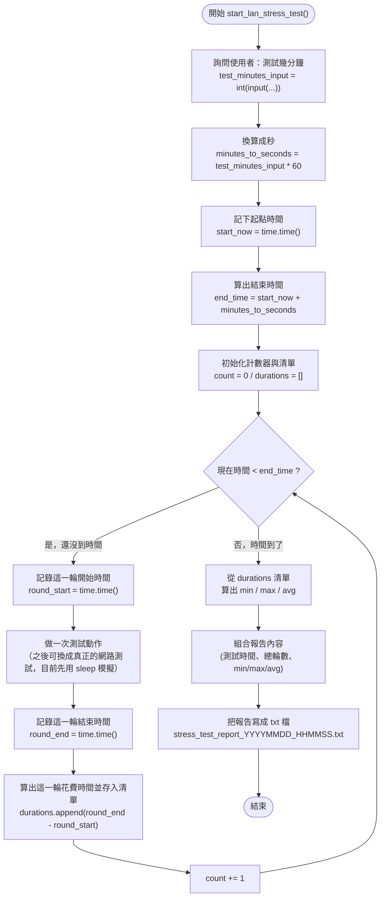

# LAN Stress Test 流程圖

## 文字版流程

1. 問使用者要測試幾分鐘，轉換成秒。
2. 記下開始時間，算出結束時間（`end_time`）。
3. 準備好 `count`（輪數計數器）和 `durations`（每輪花費時間清單）。
4. 進入迴圈，只要現在時間還沒超過 `end_time`：
   1. 記錄這一輪開始時間 `round_start`。
   2. 做一次測試動作（目前先用 `sleep` 模擬，之後可換成真正的網路測試）。
   3. 記錄這一輪結束時間 `round_end`。
   4. 計算這一輪花費時間，存進 `durations`。
   5. `count` 加 1，回到步驟 4 重新檢查時間。
5. 時間到，離開迴圈後：
   1. 用 `durations` 算出最小、最大、平均花費時間。
   2. 組合成報告文字（測試時間、總輪數、min/max/avg）。
   3. 把報告寫成一個 `.txt` 檔案，檔名帶時間戳記。
